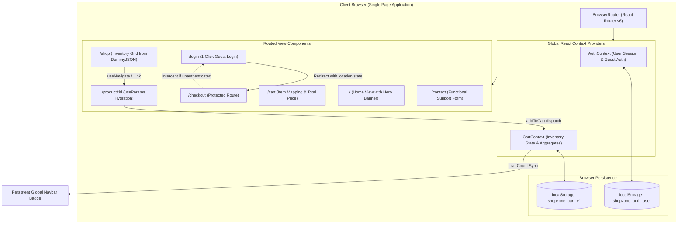

# 🛍️ ShopZone — E-Commerce Single Page Application (SPA)

> **Sprint 06 Engineering Residency Module**  
> Architecting client-side routing, global state synchronization without prop drilling, and mock route protection.

---

## 📌 Executive Summary & Submission Links

| Deliverable | Status | Link / Reference |
| :--- | :--- | :--- |
| **Live Production Deployment** | Ready for Deploy | [Deploy to Vercel (Instructions Below)](#-vercel-deployment-protocol) |
| **3-Minute QA Demo Video** | Scripted & Ready | [QA Demo Video Script & Walkthrough](./Prompts.md#-part-3-complete-3-minute-qa-demo-video-script) |
| **AI Debugging & ADR Log** | Verified | [`Prompts.md`](./Prompts.md) |
| **Mid-Pipeline 1-on-1 Standup** | Scheduled | Contact through your official residency channel |

---

## 🏛️ Application Architecture & State Flow



---

## 🚀 Key Features by Sprint Phase

### Phase 1: Base Routing Architecture (P0 Deliverables)
- **Static Client-Side Routing**: Configured clean client-side navigation using React Router DOM (`/`, `/shop`, `/contact`). All navigation utilizes `<Link to="...">` and `<NavLink>`, eliminating full-page browser reloads and preventing state erasure.
- **Dynamic Product Routing**: Configured `/product/:id` dynamic route segment. Product cards dispatch router pushes to their unique ID.
- **Data Hydration with `useParams()`**: Product detail view extracts `:id`, queries DummyJSON REST endpoints (`https://dummyjson.com/products/:id`), and renders title, high-resolution thumbnail galleries, price, rating stars, stock level, warranty, and customer reviews.
- **Functional Contact View**: `/contact` delivers a static form interface with input validation and dedicated support cards including Mr. Nakul's residency hotline.

### Phase 2: Global State Management (P1 Deliverables)
- **Context API Architecture**: Created `CartContext` wrapping the entire application tree without relying on Redux or external state engines.
- **Duplicate Prevention Dispatch (FAQ #4)**: When adding an item, dispatch logic checks whether `item.id` is already present. If found, it safely mutates the quantity attribute up to available inventory; otherwise, it appends a new item payload.
- **Real-Time UI Synchronization**: Persistent `<Navbar />` features a reactive shopping cart icon with a dynamic badge (e.g. `3`) that updates immediately on state changes.
- **Cart Aggregations (`/cart`)**: Complete cart view with quantity steppers (`-` / `+`), item removal, and computed totals:
  - **Subtotal**: Sum of unit prices &times; quantities
  - **Free Shipping Tier**: Free on orders over $50.00 (else flat $9.99)
  - **Estimated Tax**: 8% sales tax calculation
  - **Grand Total Price**: Real-time aggregated checkout sum

### Phase 3: Auth Mocking & Route Protection (P2 Deliverables)
- **LocalStorage State Persistence**: Synchronous persistence layer saves the cart array to `localStorage` on mutation and safely hydrates it on initial mount via lazy initialization.
- **Mock Authentication & 1-Click Guest Access**: `/login` route features a 1-click **"Login as Guest"** button that sets global user state to `true` with realistic profile metadata.
- **Protected Checkout Route (`<ProtectedRoute>`)**: `/checkout` intercepts unauthenticated users, redirects them to `/login`, preserves their destination in `location.state.from`, and redirects them forward after login.
- **Order Placement Simulation**: Completes transaction, generates a unique order confirmation identifier (e.g. `ORD-849204`), clears the active cart, and displays a confirmed receipt.

---

## 🗺️ Route Directory & Mapping

| Route Path | View Component | Access Level | Description |
| :--- | :--- | :--- | :--- |
| `/` | `Home.jsx` | Public | Welcome hero banner, category showcase, residency callout |
| `/shop` | `Shop.jsx` | Public | Live product grid from DummyJSON, search, department filters |
| `/product/:id` | `ProductDetails.jsx` | Public | Dynamic route hydrated via `useParams()`, gallery, add-to-cart |
| `/cart` | `Cart.jsx` | Public | Shopping bag review, quantity controls, aggregate pricing |
| `/login` | `Login.jsx` | Public | Auth view with 1-click "Login as Guest" action |
| `/checkout` | `Checkout.jsx` | **Protected** | Intercepts unauthenticated users; multi-step shipping & payment |
| `/contact` | `Contact.jsx` | Public | Functional support form & Mr. Nakul 1-on-1 sync desk |
| `*` | `NotFound.jsx` | Public | Friendly 404 page with return-to-home actions |

---

## 💻 Local Development & Build Scripts

### Prerequisites
- Node.js `v18.0.0` or higher
- npm `v9.0.0` or higher

### Installation & Execution
```bash
# Navigate to the repository
cd shopzone

# Install dependencies (react-router-dom, lucide-react, vite)
npm install

# Start local Vite development server
npm run dev
# -> Local server starts at http://localhost:3000

# Execute production build
npm run build
# -> Compiles optimized production bundle into dist/

# Preview production build locally
npm run preview
```

---

## ☁️ Vercel Deployment Protocol

### The SPA 404 Rewrite Solution (`vercel.json`)
When hosting Single Page Applications on static CDNs like Vercel, hard refreshing a direct route like `/shop` or `/cart` causes a `404 Not Found` error because the edge server looks for a physical `shop.html` file that does not exist.

To resolve this, our root repository includes a `vercel.json` configuration file:
```json
{
  "rewrites": [
    {
      "source": "/(.*)",
      "destination": "/"
    }
  ]
}
```
This instructs Vercel to route all incoming requests to `index.html`, allowing `react-router-dom` to parse the URL client-side.

### Steps to Deploy
1. Push this repository to GitHub:
   ```bash
   git init
   git add .
   git commit -m "feat: complete ShopZone SPA module Sprint 06"
   git remote add origin https://github.com/YOUR_USERNAME/shopzone.git
   git push -u origin main
   ```
2. Navigate to [Vercel Dashboard](https://vercel.com/new).
3. Import the `shopzone` repository.
4. Set Build Command: `npm run build` and Output Directory: `dist`.
5. Click **Deploy**.

---

## 📋 Sprint 06 Technical FAQ Resolution

| # | Question / Issue | Architectural Solution Implemented |
| :-: | :--- | :--- |
| **1** | **Vercel 404 on refresh** | Root `vercel.json` rewrite configuration redirecting `/(.*)` to `/index.html`. |
| **2** | **Can I use standard `<a>` tags?** | Strictly prohibited. Standard anchor tags reload the page and erase React in-memory state. Used React Router's `<Link>` and `<NavLink>`. |
| **3** | **Why does `useEffect` fire twice?** | Caused by React 18 `<React.StrictMode>` intentionally unmounting/remounting to surface side-effects. Handled with cleanup guards and `AbortController`. |
| **4** | **How to prevent duplicate items in Cart?** | Implemented `addToCart` dispatch with `findIndex(item => item.id === product.id)`. If present, increments quantity; if not, appends item payload. |
| **5** | **Vercel build fails due to case sensitivity** | All component file names and import statements use strict PascalCase matching (`Home.jsx`, `Navbar.jsx`). |
| **6** | **Falling behind sprint targets?** | Contact your residency coordinator during business hours for pipeline velocity adjustments. |

---

## 📞 Mandatory Mid-Pipeline 1-on-1 Sync

- **Directive**: Contact Mr. Nakul through your official residency channel at least ONCE this week.
- **Agenda**: 3-minute concise sync. Introduce yourself, report sprint velocity, raise any architectural blockers, or ask career guidance.
- **Contact Channel**: Provided by your residency coordinator.
- **Calling Window**: Monday – Friday | 9:00 AM – 6:00 PM IST
- **Evaluation**: Formally graded under the **Technical Communication KPI**.
